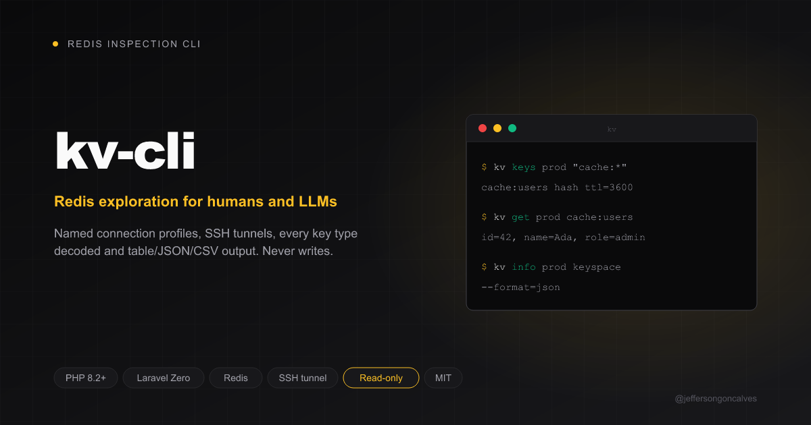

<div class="filament-hidden">



</div>

# kv-cli

[](https://buymeacoffee.com/jeffersongoncalves)

Read-only CLI to inspect Redis through named connection profiles, with
table/json/csv output. List keys with their type and TTL, read a key of any
type, check server INFO, all without remembering `redis-cli` incantations or
opening an SSH tunnel by hand. Built to pair with an LLM inspecting a cache,
queue or session store.

Sibling of [db-cli](https://github.com/jeffersongoncalves/db-cli), built with
[Laravel Zero](https://laravel-zero.com).

<p align="center">
  <a href="https://github.com/jeffersongoncalves/kv-cli/actions"></a>
  <a href="https://packagist.org/packages/jeffersongoncalves/kv-cli"></a>
  <a href="https://github.com/jeffersongoncalves/kv-cli/blob/main/LICENSE"></a>
  
</p>

## Requirements

- PHP `^8.3`. No extension needed: the Redis client ([Predis](https://github.com/predis/predis)) is pure PHP and bundled in the PHAR.

## Install

### Global (recommended)

```bash
composer global require jeffersongoncalves/kv-cli
```

The binary `kv` will be on your `PATH` as long as Composer's global
`vendor/bin` is in it.

### From source

```bash
git clone https://github.com/jeffersongoncalves/kv-cli.git
cd kv-cli
composer install
```

## Usage

### Update

```bash
kv self-update
```

### Connection profiles

Profiles are saved to `~/.kv-cli/config.json` (mode `0600`).

```bash
kv connections:add            # interactive: name, host, port, db index, ACL user, password
kv connections:list
kv connections:remove cache
```

Pass `--tls` for servers that require TLS (`rediss://`, e.g. most managed
Redis offerings). Leave `--username` empty for password-only auth (`AUTH
password`); set it for Redis 6+ ACL users.

To connect through an SSH bastion, answer yes to "Connect through an SSH
tunnel?" during `connections:add`, or pass the `--ssh-host`/`--ssh-port`/
`--ssh-username`/`--ssh-private-key` options. `host`/`port` stay Redis's
real address as seen from the bastion; the CLI opens a local port forward
through the system `ssh` client (so your `~/.ssh/config`, agent and keys
apply as usual) and tears it down when the command exits. Requires an `ssh`
client on `PATH`.

```bash
kv connections:add prod --host=127.0.0.1 --port=6379 --password="$REDIS_PASSWORD" \
    --ssh-host=bastion.example.com --ssh-username=deploy \
    --ssh-private-key=~/.ssh/id_ed25519
```

### List keys

```bash
kv keys cache
kv keys cache "laravel_cache:*" --limit=50
kv keys cache "queues:*" --db=1 --format=json
```

Uses `SCAN`, never `KEYS`, so it doesn't block the server, and stops at
`--limit` (default 100). Each key comes with its type and TTL in seconds
(`-1` = no expiry).

### Read a key

```bash
kv get cache laravel_cache:settings
kv get cache queues:default --limit=10 --format=json
```

Detects the type and reads it the right way: string, hash, list, set, zset
or stream. Collections are capped at `--limit` elements (default 100), and
the output includes the full `size` so you know whether you're seeing all of
it. Exits with code 1 if the key doesn't exist.

### Server info

```bash
kv info cache
kv info cache memory
kv info cache keyspace --format=json
```

### Output formats

Every read command accepts `--format=table|json|csv` (default `table`).
`json` is the format to reach for when piping results to an LLM or another
program.

### Read-only

The CLI only sends `SCAN`, `TYPE`, `TTL`, `INFO` and the per-type read
commands (`GET`, `HSCAN`, `LRANGE`, `SSCAN`, `ZRANGE`, `XRANGE`, and their
length counterparts). There is no passthrough for arbitrary commands, so it
is safe to point at production.

## Development

```bash
composer install
composer test       # Pest tests + Pint lint
composer lint        # Auto-fix style
composer phpstan      # Static analysis
composer build        # Build the PHAR into builds/kv
```

## License

MIT © Jefferson Goncalves
